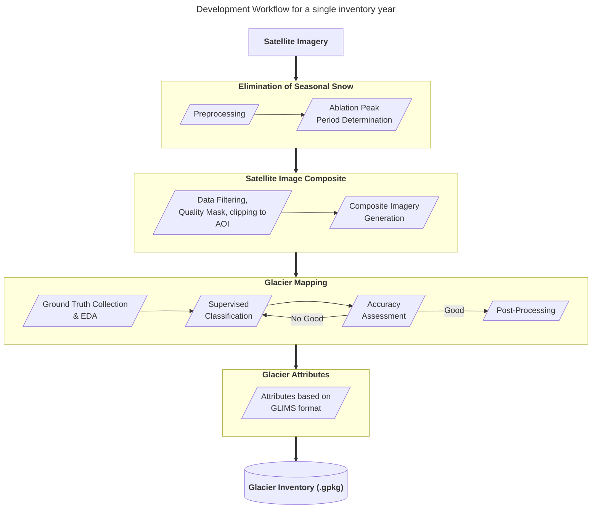

# Establishing Glacier Inventory

This repository contains geospatial resources essential for the development of glacier inventory of any designated years using open-source approach. This case study outlines overall geospatial practices in glacier mapping and final output generation using free and open-source multispectral satellites, terrain information, and softwares/platforms such as Google Earth Engine, QGIS and python.

All shared materials in this repository can be used, modified, shared with proper citations.

Supplementary materials [here](/supplementary/).
Access GEE scripts [here](/GEE_scripts/).

**Example Case Study**: Afghanistan

**Used Satellite Imagery**: Landsat series, MODIS Snow Dataset, SRTM DEM

**Softwares**: QGIS, Google Earth Engine, Python

_All materials prepared by Swun Wunna Htet (2026)._
___

Disclaimer: The applied geospatial functions can vary depending on specific conditions, and country. Refer to it with caution.

___

